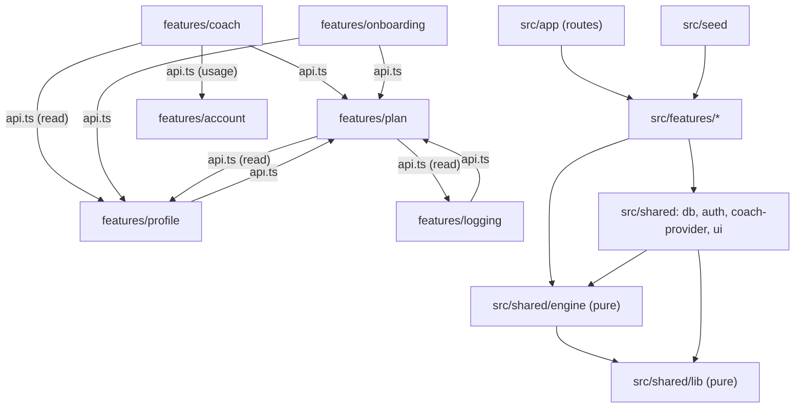
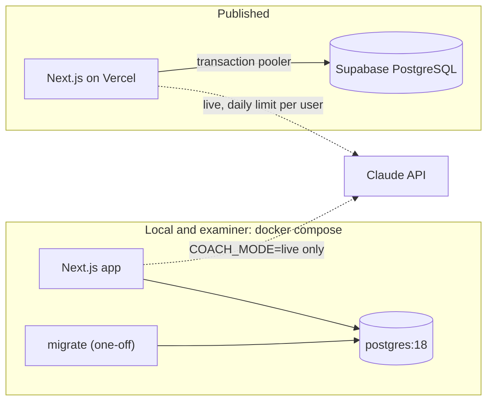
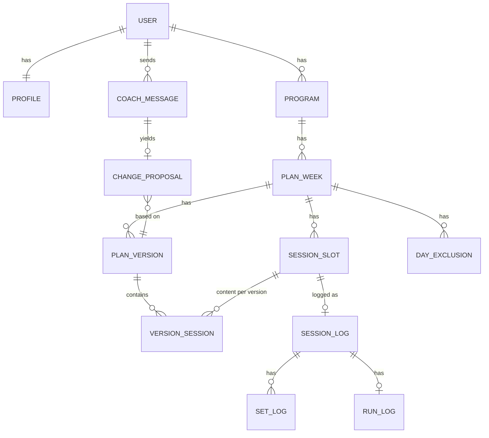

# Architecture Spine — Flex PT v1

## Design Paradigm

**Vertical slices over a shared core.** One Next.js app in one repository. Each feature is a slice with its own pages, server code and data access, and a single public surface. Everything two or more slices need lives in `shared/`. The plan engine inside `shared/` is a **functional core**: deterministic TypeScript functions with no database, network, language model, clock or framework access.

| Layer | Directory | Holds |
| --- | --- | --- |
| Routes | `src/app/` | Thin Next.js route files that render a slice's page or call a slice's server code. No business logic. |
| Feature slices | `src/features/<slice>/` | `account`, `onboarding`, `plan`, `logging`, `coach`, `profile`. Each has an `api.ts` (its only public surface), UI components, server actions and queries. |
| Shared core | `src/shared/` | `engine/` (pure plan engine, rules R1–R14, plan-change types), `db/` (Drizzle schema, client, migrations), `auth/`, `coach-provider/` (Live and Demo), `ui/` (design-system components and tokens), `lib/` (dates, validation, errors) |
| Composition | `src/seed/` | Demo seeding (AD-16). The only code outside `src/app/` that may call several slices' `api.ts`. |

## Invariants & Rules



### AD-1 — One Next.js app, vertical slices with one public surface each [ADOPTED]

- **Binds:** all
- **Prevents:** a second backend to keep in sync, and slices reaching into each other's internals or duplicating each other's writes
- **Rule:** The app is a single Next.js (TypeScript) application with no separate backend service, organised as in the table above. A slice may import another slice only through that slice's `features/<slice>/api.ts`, and only along the edges in the diagram. Functions in `api.ts` take the user id as their first argument and enforce their own rules. Code needed by two slices that is not a command or query of one owner moves to `src/shared/`. Route files contain no business logic. An ESLint import rule enforces these boundaries.

### AD-2 — The plan engine is the only author and judge of plans, and it is deterministic [ADOPTED]

- **Binds:** FR4, FR5, FR7, FR10, FR12, FR14, FR15, R1–R14, NFR6
- **Prevents:** rules implemented twice and drifting apart, the language model changing a plan directly, and results that depend on when or where code runs
- **Rule:** Plan generation, progression, step back, session status, "running goal reached", new-program generation, plan-change validation and the before → after diff are computed only by functions in `src/shared/engine`. They take all inputs as plain data, including today's date, the exercise library and the logs, and never read a clock, database or network. Their outputs (loads, reps, distances, days, R8 reductions, the fixed fast-run distance) are stored on the plan; other code displays stored values and never recomputes them.

### AD-3 — Each entity has one owning slice [ADOPTED]

- **Binds:** all data writes
- **Prevents:** two slices writing the same table with different rules
- **Rule:** Only the owning slice writes an entity. Other slices read or change it only through the owner's `api.ts`.

| Entity | Owner |
| --- | --- |
| user, session, account (Better Auth tables), coach usage counter | `account` |
| profile (focus, goal, longest run, sessions per week, equipment, main focus, experience) | `profile` (onboarding creates it through `profile.api`) |
| program (current flag, start date, fixed fast-run distance, running goal reached, week-9 answer), plan week, plan version, version session, session slot, day exclusion | `plan` |
| session log (status, effort, note), set log, run log | `logging` |
| coach message, change proposal | `coach` |

### AD-4 — All writes go through server code in the owning slice [ADOPTED]

- **Binds:** NFR2, NFR3, NFR9
- **Prevents:** writes from the browser that skip validation or user scoping
- **Rule:** Data changes happen only in Server Actions or Route Handlers inside the owning slice, or through its `api.ts`. Every write validates its input with a Zod schema on the server and gets the user id only from `shared/auth`. Every query on a user-owned table filters on that user id; a query without it is a defect. Page rendering never writes, with one exception: reading the current week goes through `plan.api.getCurrentWeek`, which calls the idempotent `ensureCurrentWeek` (AD-7) first.

### AD-5 — PostgreSQL with Drizzle as the only data access [ADOPTED]

- **Binds:** all persistence, NFR5
- **Prevents:** raw SQL scattered through slices, and different schema or migration tools
- **Rule:** PostgreSQL is the database in every environment, reached with the `postgres` (postgres.js) driver. The schema is defined once in `src/shared/db/schema` with Drizzle ORM, including the Better Auth tables, and every schema change is a `drizzle-kit` migration committed to the repo; Better Auth's own migrate command is not used. In production the app connects through Supabase's transaction pooler with prepared statements turned off, and migrations use a separate direct connection string.

### AD-6 — Better Auth owns identity and sessions [ADOPTED]

- **Binds:** FR1, FR16, NFR1, NFR2, NFR3
- **Prevents:** a hand-written password or session scheme beside the library
- **Rule:** Registration, login, logout and sessions use Better Auth with its Drizzle adapter, with the `nextCookies()` plugin last so Server Actions can set cookies. Server code gets the current user only through a `shared/auth` helper that returns the user id or rejects the request. "Prøv demo" signs in as a seeded demo user through Better Auth; there is no bypass of authentication.

### AD-7 — A plan version covers one week, is immutable, and is created exactly once per change [ADOPTED]

- **Binds:** FR3, FR4, FR11, FR15, R13, NFR9
- **Prevents:** two slices disagreeing on what a version contains, a week generated twice, and a stale proposal overwriting a newer plan
- **Rule:** A user has exactly one current program (a unique partial index on the current flag). A plan week belongs to one program and one Monday (`week_start`), with a series of versions and a stored pointer to its current version. A version is never edited. Generating a week creates its version 1; an approved proposal or a profile change that keeps the program creates the next version of the current week; a new program (R13 "Ja, nytt program", a focus change or a new running goal) becomes the current program with a new plan week for the current `week_start`. `plan.api.ensureCurrentWeek(userId, today)` is the only way a week is created; it is idempotent through a unique key on (program, week_start), only creates the week that contains today, and never fills in skipped weeks. Every read of "this week" by any slice goes through `plan.api.getCurrentWeek`, which calls it first. Every proposal records the version it was based on; approval is rejected as `stale` if that is not the current version of the current week of the current program.
- **Profile changes:** `profile` saves the change and calls `plan.api.replanFromToday`. A focus change or a new running goal starts a new program; any other change creates a new version of the current week from today. Before saving, `profile` shows the engine's before → after lines and asks the user to confirm (FR3).
- **Program state:** the answer to the week-9 card (`new` or `continue`, R13) is stored on the program. "Running goal reached" is set by `plan.api.recordFinishedSession`, which `logging` calls when a session is finished, using the engine's check (R14); it belongs to that program, so a new goal starts unset.

### AD-8 — Sessions have a stable identity across versions [ADOPTED]

- **Binds:** FR3, FR5, FR7, FR17, NFR9, NFR11
- **Prevents:** logs pointing at a session that a newer version no longer contains, sessions logged twice, and counters counting against the wrong version
- **Rule:** Each planned session in a week is a **session slot** with an id that stays the same in every version of that week. What the session contains in a given version (day, type, exercises, sets, reps, loads, distance, R8 reduction) is a **version session** row (version, slot, content), so older versions never change. A moved, reduced or swapped session keeps its slot id and gets new content in the new version; a slot gets a new id only when a session is added. Logs reference the slot, never a version. A slot that is logged or lies in the past is never changed or removed by a new version. One session log per slot, enforced by a unique key, and one set log per (session log, exercise, set number); repeating the same request returns the existing row. A session log is `in_progress` from the first logged set until «Fullfør økt», then `finished`; the server rejects changes to a finished log. Each set is saved when it is logged, so an active session is restored from the database (NFR11).

### AD-9 — The coach is one interface with a Live and a Demo provider [ADOPTED]

- **Binds:** FR9–FR13, NFR1, NFR4, NFR7
- **Prevents:** coach logic that only works with a key, slices calling the language model directly, and unbounded API spend on the published site
- **Rule:** `shared/coach-provider` exposes one interface. Demo users always get the Demo provider; other users get the provider set by `COACH_MODE` (`live` or `demo`). Only the Live provider talks to the language model, through the official `@anthropic-ai/sdk`, with the model id in configuration (default `claude-haiku-5-5`). It asks for a structured result with a JSON schema derived from the engine's plan-change types (AD-10), checks `stop_reason` before reading content, and validates the result with Zod. A refusal, timeout, invalid result or API error gives a clear message and leaves the plan unchanged. Each non-demo user may send at most a configured number of messages per day (default 20, Europe/Oslo day); above the limit the app answers with a fixed message and makes no call. The Demo provider matches the normalised message against keyword rules stored with recorded responses in `data/coach-demo/`, one file per scenario that reaches a provider (the Appendix C scenarios that are not medical, plus a time-limited session, C9). Recordings contain plan changes as intents (AD-10), never slot or exercise ids, so the engine applies them to whatever the demo user's current week is. A message that matches none gets a fixed "demo" reply.

### AD-10 — A proposal is a list of typed plan changes; code computes the result [ADOPTED]

- **Binds:** FR10, FR11, FR12, FR15, R8, R9, R10
- **Prevents:** the proposal shape defined twice, and the model setting loads, sets or distances
- **Rule:** The engine defines a closed set of plan changes: exclude days, move a session, drop a session, reduce a session (R8, reason energy or time), swap an exercise, swap to bodyweight. A proposal is a list of these with the user-facing coach text. The model never supplies numbers or exercise ids; the engine resolves them, validates the result against R1–R14, and returns the new version and the before → after lines shown on the proposal card. A broken rule discards the proposal and returns the rule-break explanation from code. The proposal's status is one of `pending`, `approved`, `rejected`, `stale`, `discarded`. Approval is one command, `coach`'s approve action: in one database transaction it calls `plan.api.applyChanges` (which checks the base version and creates the new version) and sets the status to `approved`. Approving an already approved proposal returns the existing result without creating anything.

### AD-11 — Medical statements are caught in code, and code offers the swap [ADOPTED]

- **Binds:** FR13, R11, NFR4
- **Prevents:** symptom statements being sent to an external service, the medical reply worded by the model, and "knee hurts → swap?" having no path
- **Rule:** Before a chat message reaches any provider, `coach` runs `classifyMedical`, a deterministic match against two Norwegian word lists: **acute symptoms** (for example chest pain, fainting, breathlessness, paralysis) and **pain or injury**, the second also returning any body part it recognises. On any match the app returns the fixed R11 reply (a constant in code) and does not send the message. Only for pain or injury with a body part, and never for an acute symptom, if the current week has exercises for that body part, code shows a fixed yes/no offer to swap; "yes" creates a swap-exercise proposal through the engine (AD-10), which the user approves as usual. If the model's structured result has `medicalCondition: true`, the whole result is dropped and the R11 reply is shown.

### AD-12 — Only training fields leave the app [ADOPTED]

- **Binds:** NFR4
- **Prevents:** name, email or free-text notes reaching the language model
- **Rule:** The Live provider receives only the current message, the current plan version and the training profile fields (focus, goal, sessions per week, equipment, experience). Name, email, session notes and chat history are never sent. Message contents are not written to application logs.

### AD-13 — Time is Monday to Sunday in Europe/Oslo [ADOPTED]

- **Binds:** FR4, R9, R13, NFR9
- **Prevents:** slices disagreeing on which week or day a session belongs to
- **Rule:** One helper in `shared/lib` turns a moment into the `Europe/Oslo` calendar date, its `week_start` (Monday) and the program's week number (weeks since the program's first `week_start`, counted from 1). Planned and performed days are stored as calendar dates; moments are UTC timestamps. A program started mid-week gets a first week with only the days from the start date onward in the R9 day pattern.

### AD-14 — Theme choice lives on the device [ADOPTED]

- **Binds:** FR3, NFR8
- **Prevents:** the theme stored both in a cookie and in the database, and a flash of the wrong theme
- **Rule:** The light/dark/system choice is stored in a cookie and read on the server, which sets `data-theme="light"` or `"dark"` on `<html>`, or no attribute for system. Tailwind's `dark` variant is defined on that attribute, with the system media query used when it is absent. The choice is not stored in the database.

### AD-15 — One set of design tokens [ADOPTED]

- **Binds:** NFR8, the UX documents
- **Prevents:** screens picking their own colours, sizes and component styles
- **Rule:** The colours (light and dark), typography and shapes from DESIGN.md are defined once as Tailwind CSS theme tokens. Components use only these tokens, and shared components live in `shared/ui`.

### AD-16 — Demo data is created through the same code as real data [ADOPTED]

- **Binds:** NFR1, Story 1.4, Story 4.5
- **Prevents:** seed data that breaks the rules or goes stale, and hard-coded ids or dates
- **Rule:** `src/seed` builds a demo user for a profile A–D by calling the slices' `api.ts` functions, using dates relative to today and generated ids. «Prøv demo» lets the visitor pick a profile and creates a fresh demo user for that visit, so visitors never share data; demo users older than 24 hours are deleted when the next demo user is created. Demo users are marked as demo, cannot change email or password, and use the Demo provider; the "Demo" badge shows whenever a demo user is signed in. The same code creates the fixtures for the end-to-end tests.

### AD-17 — Environments run the same app from environment variables [ADOPTED]

- **Binds:** NFR1, NFR3, NFR5
- **Prevents:** a setup that runs only on one machine, secrets in the repository, and a published site that differs from what the examiner runs
- **Rule:** Configuration comes only from environment variables; `.env` is git-ignored and `.env.example` lists every variable.

| Environment | App | Database | Coach | Migrations and seed |
| --- | --- | --- | --- | --- |
| Local and examiner | `docker compose up`: app image (Next.js standalone) | `postgres:18`, volume at `/var/lib/postgresql`, healthcheck | `COACH_MODE=demo` by default; `live` with own `ANTHROPIC_API_KEY` | A one-off compose service runs the migrations before the app starts; demo users are created on «Prøv demo» |
| Development without Docker for the app | `npm run dev` | the compose PostgreSQL | as above | `npm run db:migrate` |
| Published | Vercel, deployed from `main` only | Supabase PostgreSQL (transaction pooler; direct URL for migrations) | `COACH_MODE=live` with the daily limit; demo users always on Demo | Run with the direct URL before a deploy that needs them |

Vercel preview deployments are not connected to a database. A free Supabase project pauses after a week without use and must be resumed before a demonstration.

### AD-18 — Rules are tested in the engine, flows end to end [ADOPTED]

- **Binds:** NFR6, Story 4.5
- **Prevents:** rule tests spread through UI tests, and untested progression rows
- **Rule:** Vitest tests the engine directly (`tests/engine`): profiles A–D against Appendix B, one test per progression-table row, and each plan-change type. `tests/coach` covers `classifyMedical` (including the two medical Appendix C scenarios) and the non-medical Appendix C scenarios against the Demo provider. `tests/integration` runs against a test database for transactions, idempotency and the account-deletion cascade. Playwright (`tests/e2e`) covers the main flows in demo mode.

## Consistency Conventions

| Concern | Convention |
| --- | --- |
| Language | Code, identifiers and commit messages in English; all user-facing text in Norwegian bokmål (NFR10). |
| Naming | Files and folders in kebab-case; React components in PascalCase; tables and columns in snake_case; TypeScript types in PascalCase. |
| Ids | UUIDs for app tables; user ids are Better Auth's string ids. |
| Data formats | Calendar dates as `YYYY-MM-DD`; timestamps in UTC; distances in km with one decimal; durations in whole seconds; loads in kg rounded to 0.5, `null` for bodyweight. |
| Errors | Server actions return `{ ok: true, data }` or `{ ok: false, code, message }` with a Norwegian message; no stack traces reach the browser. |
| Next.js 16 | Request APIs such as `cookies()` and `headers()` are awaited. |
| Deletion | Deleting an account removes all the user's rows through foreign keys with cascade (FR16); a test checks that nothing remains. |
| Style | ESLint (including the slice boundary rule) and Prettier pass before a pull request. |

## Stack

| Name | Version |
| --- | --- |
| Node.js | 24 (LTS) |
| TypeScript | 7.0 |
| Next.js | 16.4 |
| React | 19.3 |
| PostgreSQL | 18 |
| postgres (postgres.js) | 4.1 |
| Drizzle ORM / drizzle-kit | ~0.45 / 0.31 |
| Better Auth (+ Drizzle adapter) | 1.7 |
| Anthropic SDK (`@anthropic-ai/sdk`) | 1.9 |
| Coach model | `claude-haiku-5-5` (configurable) |
| Zod | 4.6 |
| Tailwind CSS | 4.3 |
| Vitest | 5.1 |
| Playwright | 1.65 |
| ESLint / Prettier | 10.15 / 3.10 |
| Hosting | Vercel (app), Supabase (PostgreSQL) |

## Structural Seed





```text
flex-pt/
  src/
    app/                 # thin routes and layouts
    features/
      account/           # api.ts, register, log in, log out, delete, demo login, coach usage
      onboarding/        # api.ts, five-step onboarding
      plan/              # api.ts, week plan, programs, weeks, versions, slots, new program, running goal
      logging/           # api.ts, session overview, set and run logging, finish, history
      coach/             # api.ts, chat, classifyMedical, proposals, approve or reject
      profile/           # api.ts, profile, theme, running goal
    shared/
      engine/            # pure rules R1–R14, generation, progression, plan changes, diff
      db/                # Drizzle schema (incl. Better Auth), client, migrations
      auth/              # Better Auth setup and current-user helper
      coach-provider/    # interface, Live (Anthropic SDK), Demo (recorded files)
      ui/                # design-system components and Tailwind tokens
      lib/               # dates (Europe/Oslo), validation helpers, errors
    seed/                # demo users A–D through the slices' api.ts
  data/
    exercises/           # curated Free Exercise DB subset
    coach-demo/          # recorded coach responses per scenario
  tests/
    engine/              # Vitest: profiles A–D, progression table, plan changes
    coach/               # Vitest: classifyMedical, Demo provider scenarios
    integration/         # Vitest + test database: transactions, idempotency, deletion cascade
    e2e/                 # Playwright flows in demo mode
  Dockerfile
  docker-compose.yml
  .env.example
```

## Capability → Architecture Map

| Capability / Area | Lives in | Governed by |
| --- | --- | --- |
| FR1, FR16, NFR1 demo login | `features/account`, `shared/auth` | AD-4, AD-6, AD-16 |
| FR2 onboarding | `features/onboarding` | AD-3, AD-4, AD-13 |
| FR3 profile, theme, running goal | `features/profile`, `features/plan` | AD-7, AD-8, AD-14 |
| FR4, FR5, FR6, FR14, FR15 week plan and progression | `features/plan`, `shared/engine` | AD-2, AD-7, AD-8, AD-13 |
| R13 8-week program, R14 running goal | `features/plan`, `shared/engine` | AD-2, AD-7, AD-13 |
| FR7, FR8, FR17, NFR11 logging, history, finished session | `features/logging` | AD-2, AD-8 |
| FR9–FR13 coach | `features/coach`, `shared/coach-provider`, `shared/engine` | AD-9, AD-10, AD-11, AD-12 |
| NFR6 tests | `tests/engine`, `tests/e2e` | AD-18 |
| NFR8 accessibility and themes | `shared/ui` | AD-14, AD-15 |
| NFR5 local run, environments | `Dockerfile`, `docker-compose.yml`, `.env.example` | AD-17 |

## Deferred

- **Supabase PostgreSQL version:** not verified; the app uses nothing beyond PostgreSQL 15, so a version gap with the local `postgres:18` does not matter.
- **Exercise library file format:** decided in Story 2.1, within `data/exercises/` and the gym/home marking from R5.
- **The medical word list and body-part map:** written and tested in Story 4.4, under AD-11.
- **Rate limiting beyond the coach, monitoring and backups:** not needed for a course MVP; revisit before any real launch.
- **CI pipeline:** tests run locally and before pull requests; a GitHub Actions workflow can be added without changing any AD.
- **Who holds the Anthropic API key:** a team decision (PRD §8); the app needs `ANTHROPIC_API_KEY` only when `COACH_MODE=live`.
- **Combined running and strength, stage 2 and 3 features:** out of scope for v1 (PRD §6).
